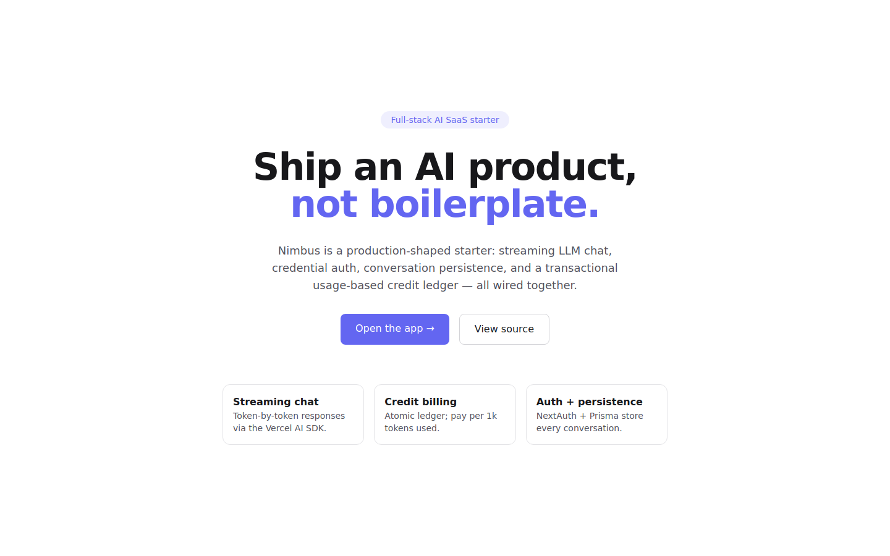
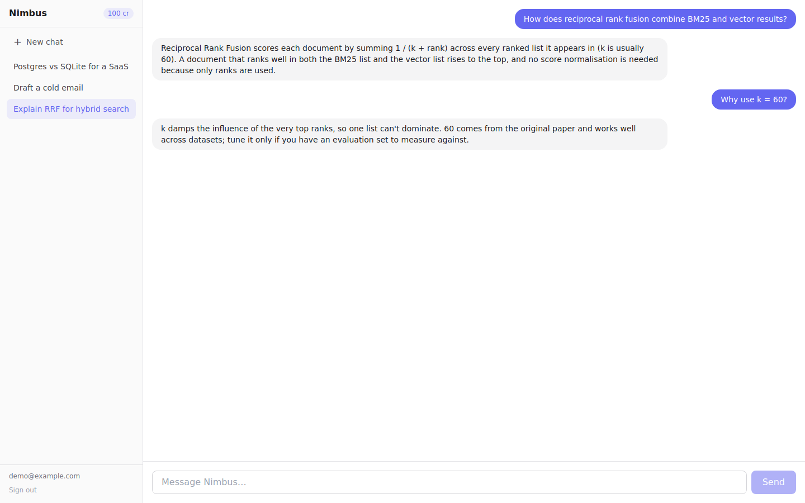
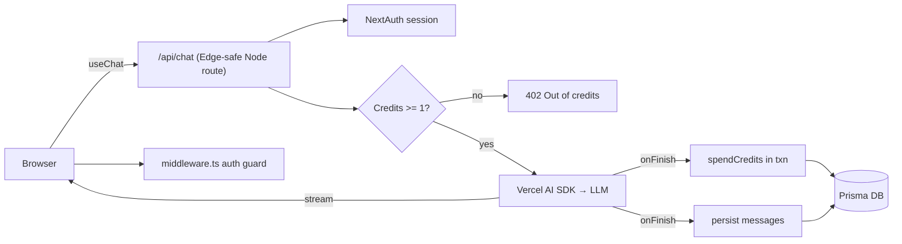

# 🌩️ Nimbus AI

> A production-shaped, full-stack **AI SaaS starter** — streaming LLM chat with authentication, conversation persistence, and a transactional **usage-based credit billing** ledger.

[](https://github.com/WickTech/nimbus-ai/actions/workflows/ci.yml)


Nimbus is the part everyone rebuilds from scratch when shipping an AI product: auth, a database, streaming responses, and a way to *charge for tokens without losing money*. It's deliberately small enough to read in one sitting, but wired the way a real SaaS would be.

| Landing | Chat with saved conversations and credit balance |
|---|---|
|  |  |

<sub>Screenshots are from a local run. The chat shows a seeded sample conversation, because no model API key was configured.</sub>

---

## ✅ Current Status

| | |
|---|---|
| **Tests** | 42 unit and integration tests (real SQLite, 77% line coverage) + 14 browser tests (Playwright, including accessibility) |
| **TypeScript** | Strict — zero `any`, zero type errors |
| **Build** | Production build clean (`npm run build`) |
| **CI** | GitHub Actions: typecheck → tests with coverage → build, plus a browser-test job, on every push and PR |
| **Deployment** | `Dockerfile` + `vercel.json` ready |

---

## ✨ Features

| | |
|---|---|
| 💬 **Streaming chat** | Token-by-token responses via the [Vercel AI SDK](https://sdk.vercel.ai) — works with OpenAI or any compatible endpoint (Ollama, Groq, Together). |
| 🔐 **Auth** | Credential auth with NextAuth v5 (JWT sessions) + Prisma adapter. Protected routes via middleware. |
| 🗄️ **Persistence** | Every conversation and message stored in Prisma (SQLite locally, Postgres in prod). |
| 🪙 **Credit billing** | Append-only `CreditLedger` with atomic, transactional spend/grant. 1 credit ≈ 1k tokens. Wallets can't go negative or drift from the ledger. Stripe Checkout top-up built in. |
| 💬 **Markdown chat** | Assistant responses render as rich Markdown (react-markdown + rehype-sanitize): headings, lists, inline/block code, bold. Safe — no XSS. |
| 🔭 **LLM observability** | Optional [Langfuse](https://langfuse.com) tracing over OpenTelemetry — set `LANGFUSE_PUBLIC_KEY`/`LANGFUSE_SECRET_KEY` and every chat completion is traced with prompt, output, tokens, latency, user and conversation (Langfuse *Users* / *Sessions* views give per-user cost). `LANGFUSE_RECORD_IO=false` sends metadata only. Zero overhead when unset. |
| 🧪 **Tested** | The billing core is tested on a real database under parallel load, and the whole product is tested in a real browser (the parts where bugs cost real money). |
| 🚢 **Deploy-ready** | Multi-stage `Dockerfile`, GitHub Actions CI, one-click Vercel config. |

---

## 🏗️ Architecture



**Billing flow:** requests are gated *before* calling the model (no wallet, no
spend), then reconciled in `onFinish` once the real token usage is known — all
inside a DB transaction so the running balance and the ledger never diverge.

```
src/
├── app/
│   ├── api/chat/route.ts      # streaming chat + billing reconciliation
│   ├── api/register/route.ts  # signup + free-credit grant
│   ├── (dashboard)/chat/      # protected chat UI
│   ├── login / register       # auth pages
│   └── page.tsx               # marketing landing
├── lib/
│   ├── credits.ts             # ⭐ transactional ledger (tested on a real DB)
│   ├── auth.ts                # NextAuth config + password hashing
│   ├── ai.ts                  # provider wrapper
│   └── db.ts                  # Prisma singleton
└── middleware.ts              # route protection
```

---

## 🚀 Quick start

```bash
git clone https://github.com/WickTech/nimbus-ai && cd nimbus-ai
npm install
cp .env.example .env            # add your OPENAI_API_KEY + AUTH_SECRET
npm run db:push                 # create the SQLite schema
npm run db:seed                 # optional: demo@nimbus.ai / password123
npm run dev                     # http://localhost:3000
```

No OpenAI key? Point `OPENAI_BASE_URL` at a local Ollama server
(`http://localhost:11434/v1`) and set `OPENAI_MODEL=llama3`.

---

## 🧪 Tests & quality

```bash
npm test               # 42 Vitest tests on a throwaway SQLite database (about 7 s)
npm run test:coverage  # the same, with coverage and thresholds
npm run build && npm run test:e2e   # 14 browser tests (Playwright) against the production build
npm run typecheck      # strict TypeScript, no emit
```

| Layer | What it proves |
|---|---|
| **Credit ledger** (real database) | 40 parallel spends can never overdraw the balance; every spend leaves exactly one ledger row; the ledger always adds up to the balance, even with grants and spends racing; a refused spend changes nothing |
| **Sign-up** | Free credits and a ledger entry, scrypt-hashed passwords, case-insensitive duplicates, validation, 5 sign-ups per hour per address |
| **Chat endpoint** (mock model, no network) | 1 credit reserved before the model is called; a long answer is billed from its real token usage; 402 at zero balance; **a failed model call is refunded**; nobody can write into another user's conversation |
| **Browser** (fake OpenAI server, no key) | Sign up and sign in, chat, credits drop, history survives a reload, a clear out-of-credits message, a failed call costs nothing, wrong password shows an error, sign-out locks the chat, one user can't open another's conversation |
| **Accessibility** (axe, WCAG 2.1 AA) | No automatic violations on the home, login, register and chat pages |

The browser tests need no API key: the app already talks to any OpenAI-compatible server through `OPENAI_BASE_URL`, so they use a tiny fake one (`e2e/fake-openai.mjs`) that answers deterministically and reports token usage.

Unit-level coverage is about 77% of lines and 89% of branches; the rest is authentication wiring that only the browser tests exercise. CI runs everything on every push and PR (`.github/workflows/ci.yml`).

> **SQLite note:** local development uses SQLite, which allows one writer. `DATABASE_URL` therefore ends in `?connection_limit=1` (see `.env.example`) so simultaneous requests queue instead of timing out. Postgres in production does not need it.

---

## 🛠️ Tech stack

**Next.js 15** (App Router, Server Actions) · **TypeScript** (strict) ·
**NextAuth v5** · **Prisma** · **Vercel AI SDK** · **Tailwind CSS** ·
**Vitest** · **Docker**

---

## 🗺️ Roadmap

Features planned for future iterations:

- [x] **GitHub sign-in** — optional, enabled when `GITHUB_CLIENT_ID` is set (Google not added)
- [x] **Stripe credit top-ups** — buy credits via Stripe Checkout; webhook reconciles the ledger (`POST /api/stripe/checkout` + idempotent `/api/stripe/webhook`; buy from Account → Credits)
- [x] **Chat history** — sidebar plus `/history` with search, rename, delete and pagination
- [x] **Account area** — profile, password change, ledger, credit purchase, account deletion
- [x] **Chat polish** — mobile drawer, stop/copy, low-credit banner
- [x] **Markdown rendering** — assistant responses render as rich Markdown (react-markdown + rehype-sanitize); headings, lists, inline/block code, bold
- [ ] **Multi-model selector** — let users choose GPT-4o, Claude, Mistral etc. per conversation
- [ ] **Rate limiting** — done for register/login/account; chat route and a shared (Redis) store still open
- [ ] **Team workspaces** — shared credit pools with role-based access
- [ ] **Usage analytics dashboard** — per-user token spend, daily active users, credit burn charts
- [x] **Postgres in production** — Vercel build swaps the Prisma provider and pushes the schema
- [ ] **Email verification** — confirm email on signup; lock unverified accounts

---

## 📈 What this demonstrates

- Designing a **money-safe** billing primitive (atomic, append-only, auditable).
- Real-time streaming UX with graceful credit/error handling.
- Clean separation: provider, persistence, auth, and billing are each isolated and swappable.
- End-to-end ownership: schema → API → UI → tests → CI → container.

## 📄 License

MIT — see [LICENSE](./LICENSE).
